<p align="center">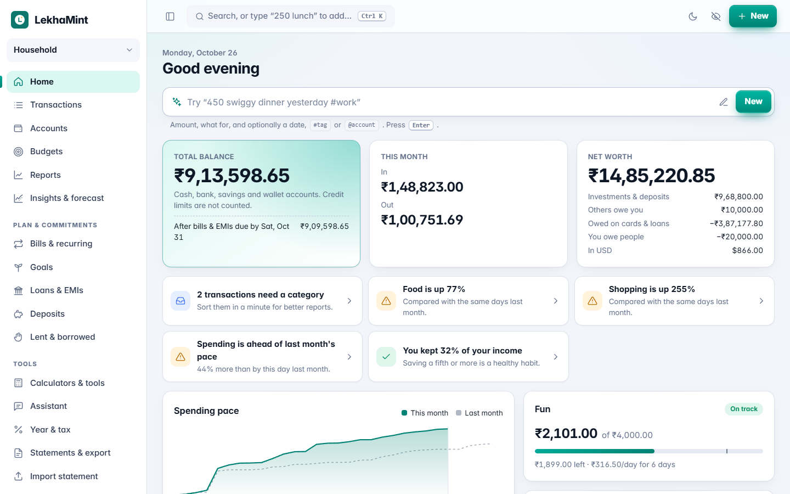</p>

<h1 align="center">LekhaMint</h1>

<p align="center"><b>A modern, private money manager you host yourself.</b><br>
Android app, web app and a tiny sync server. Exact to the paisa, works offline, no cloud, no tracking.</p>

<p align="center">
<a href="https://anand34577.github.io/lekhamint/"><b>Live demo</b></a> ·
<a href="#install">Install</a> ·
<a href="https://github.com/anand34577/lekhamint/wiki">Docs</a> ·
<a href="https://github.com/anand34577/lekhamint/releases/latest">Download</a>
</p>

<p align="center">
<a href="https://github.com/anand34577/lekhamint/actions/workflows/ci.yml"></a>
<a href="https://github.com/anand34577/lekhamint/releases/latest"></a>
<a href="LICENSE"></a>
</p>

> *Lekha* (लेखा) means "account" or "record": LekhaMint keeps a clear, exact record of your money.

## Try it now

**[Open the live demo](https://anand34577.github.io/lekhamint/)** and sign in with **`demo@example.com`** / **`demo1234`**. It is the real server compiled to WebAssembly, running in your browser on a year of sample household data. Nothing is sent anywhere, and it resets when you reload.

## Screenshots

| Transactions | Reports |
| --- | --- |
| 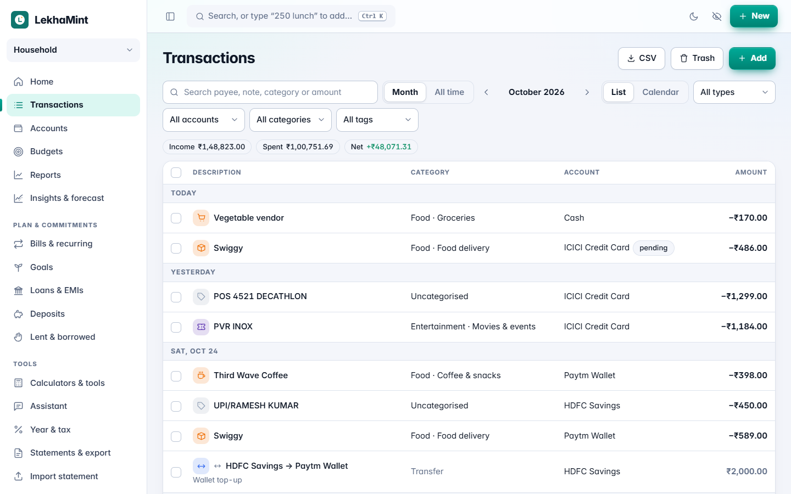 | 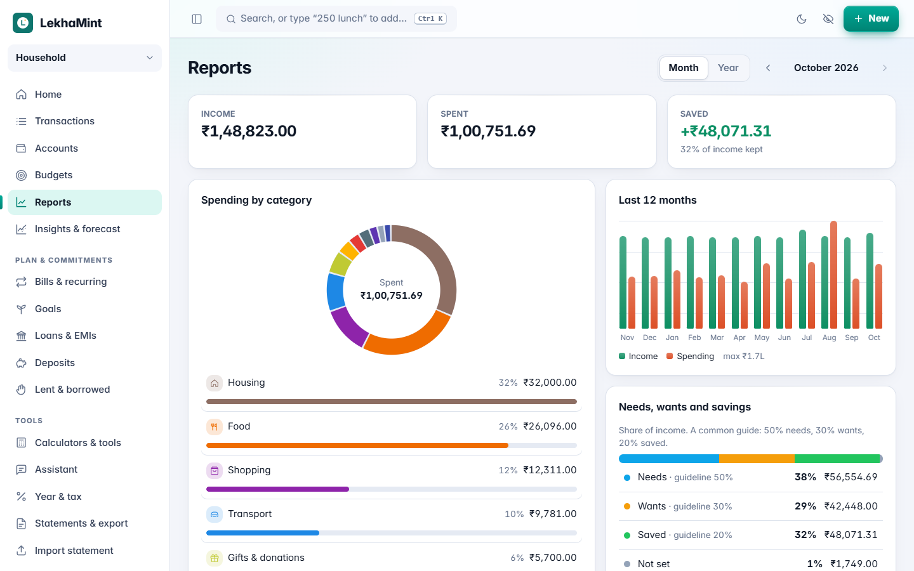 |
| **Budgets** | **Accounts** |
| 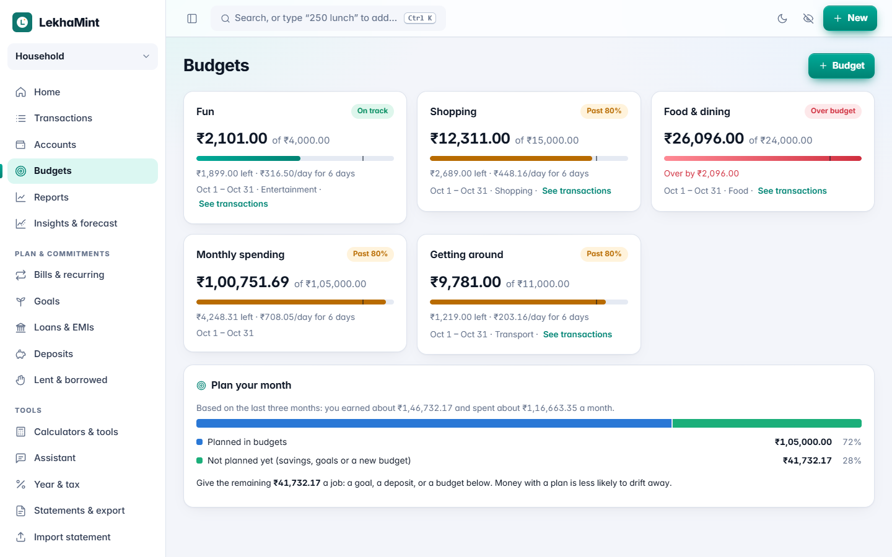 | 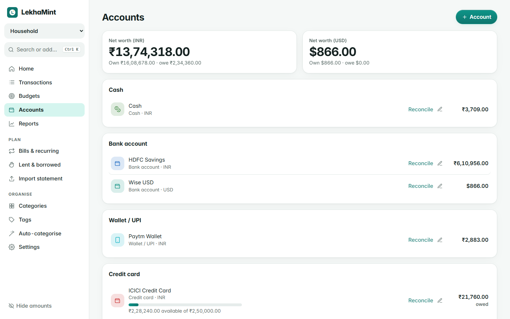 |
| **Bills & recurring** | **Dark theme** |
| 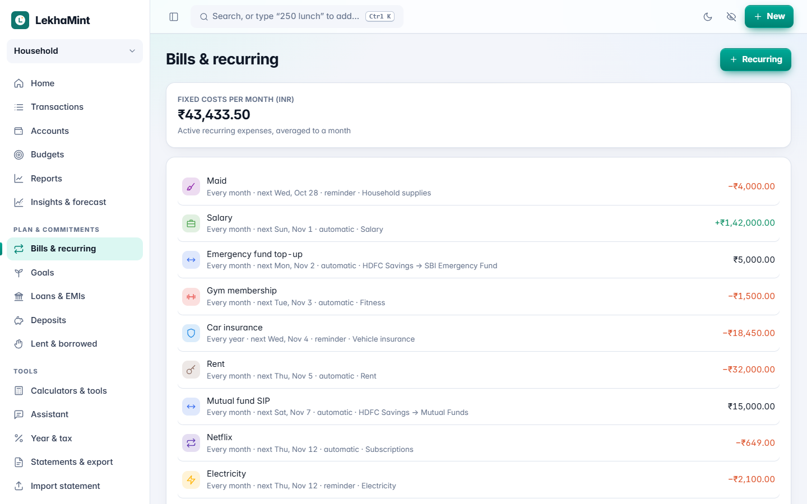 | 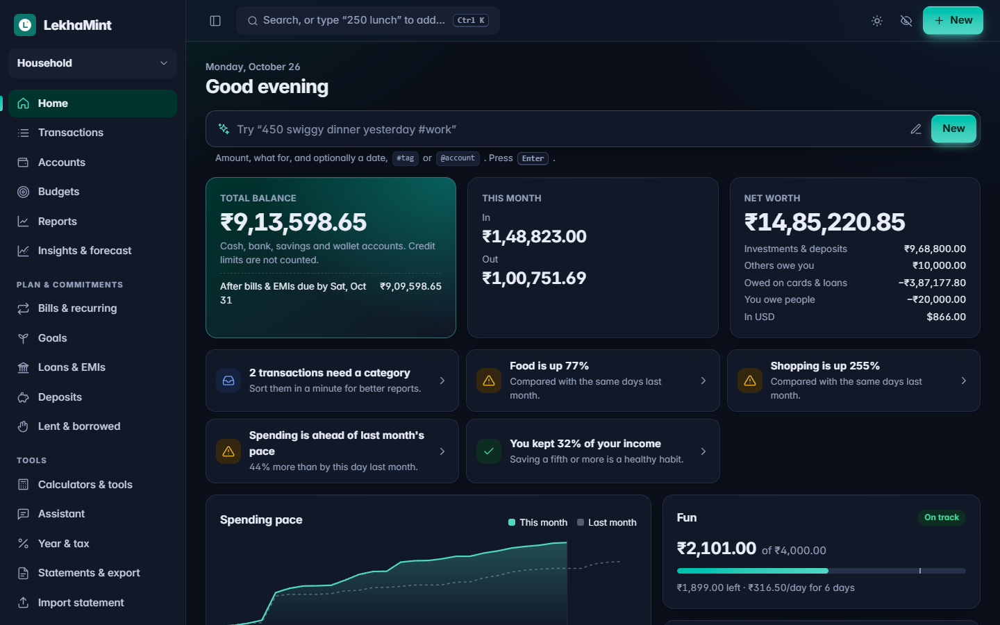 |

<p align="center">
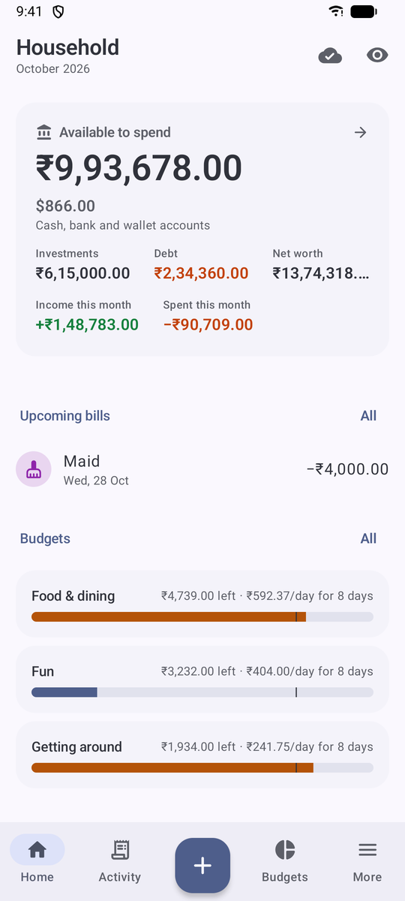
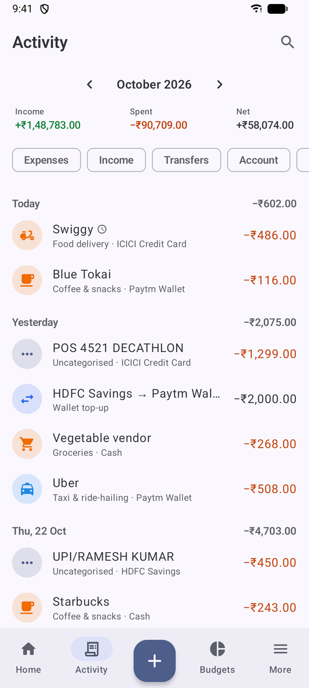
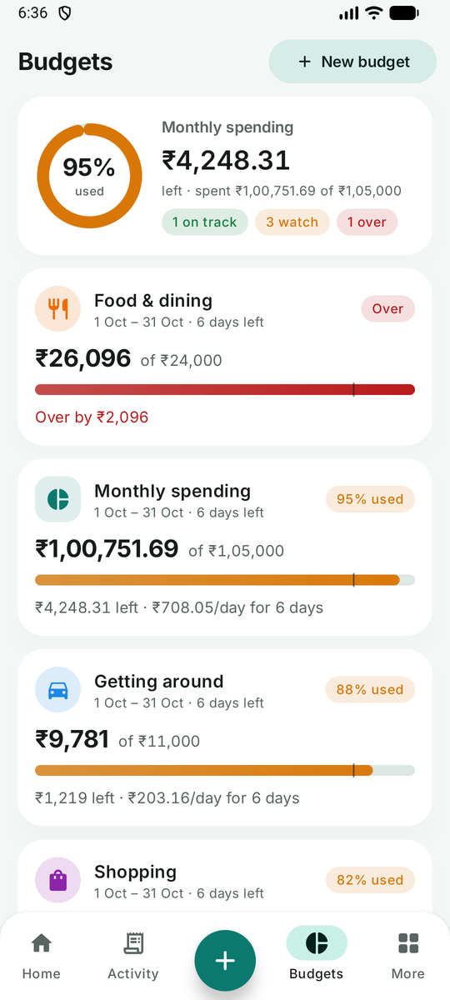
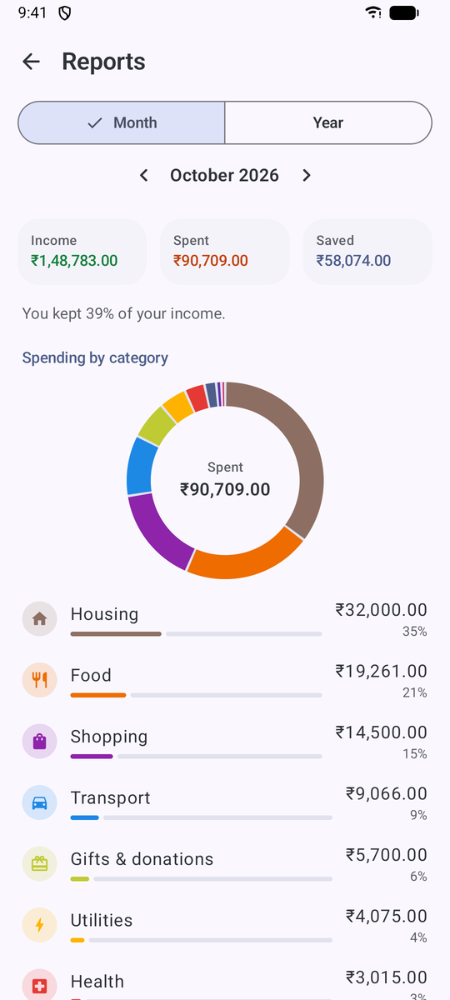
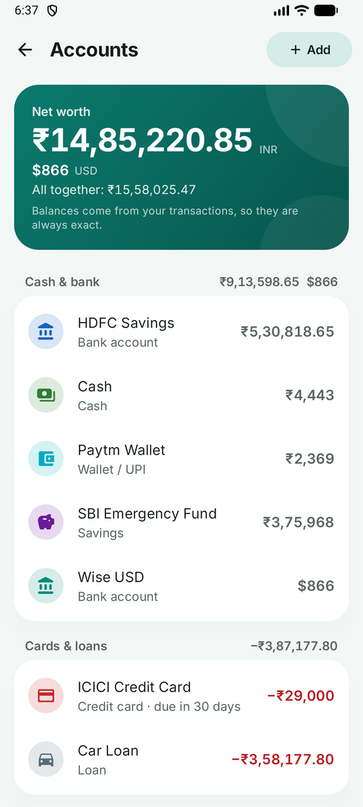
</p>

## Features

- **Fast entry.** Add an expense in about five seconds: a calculator keypad on Android, and quick add in plain words on the web (`450 swiggy dinner yesterday #work @hdfc`).
- **Correct accounting.** Transfers and card payments are not spending, refunds reduce spending, and loans to friends never count as income or expense. Balances are always calculated from transactions, never typed in.
- **Budgets** per category or account, weekly to yearly, with rollover, a daily allowance and a pace warning.
- **Reports:** category breakdown, 12-month trend, needs/wants/savings, income sources, top payees and tags.
- **Bills & recurring** items that remind you or record themselves, without duplicates across devices.
- **Lent & borrowed** with partial repayments and due dates.
- **Multi-currency** accounts, transfers between currencies, and totals converted with your own exchange rates.
- **Splits, tags and auto-categorise rules** that also clean up messy payee names.
- **Bank statement import** (CSV): importing the same file twice adds nothing.
- **Family sharing** with owner, editor and viewer roles; see and sign out devices.
- **Android app that works fully offline**, with a home-screen widget, quick settings tile, app lock, hide amounts, Material You and true-black themes, and encrypted automatic backups.
- **Web app** with a command palette (Ctrl/⌘ K), keyboard shortcuts, insights and a spending-pace chart. It installs like an app.
- **Self-hosting made easy:** one small program or one Docker image, SQLite built in (PostgreSQL optional), automatic backups, health checks and structured logs. It runs happily on a Raspberry Pi.

## Install

The server includes the web app. Run one of these on the computer that will host it, then open the address it prints and create your account.

**Linux and macOS**

```sh
curl -fsSL https://raw.githubusercontent.com/anand34577/lekhamint/main/install.sh | sh
```

**Windows** (PowerShell; run as Administrator to start it with Windows)

```powershell
irm https://raw.githubusercontent.com/anand34577/lekhamint/main/install.ps1 | iex
```

**Docker**

```sh
docker run -d --name lekhamint --restart unless-stopped -p 8080:8080 -v lekhamint-data:/data ghcr.io/anand34577/lekhamint:latest
```

or with Compose: `curl -fsSLO https://raw.githubusercontent.com/anand34577/lekhamint/main/docker-compose.yml && docker compose up -d`. No Docker yet? `curl -fsSL https://get.docker.com | sh`, or add `--docker` to the Linux one-liner and it installs Docker for you.

The installers check the download's SHA-256, set up a service that starts on boot and restarts on failure, and upgrade in place when you run them again. Details, options and manual installs: **[Installation](https://github.com/anand34577/lekhamint/wiki/Installation)** · [Docker](https://github.com/anand34577/lekhamint/wiki/Docker) · [HTTPS and remote access](https://github.com/anand34577/lekhamint/wiki/Reverse-Proxy) · [Configuration](https://github.com/anand34577/lekhamint/wiki/Configuration).

**Android:** download `LekhaMint.apk` from the [latest release](https://github.com/anand34577/lekhamint/releases/latest) and install it. Use it on its own, or connect it to your server under **More → Sync** ([guide](https://github.com/anand34577/lekhamint/wiki/Android-App)).

## How it fits together

```
  Android app (offline-first)           Web app (any browser)
            │                                    │
            └────────── sync over HTTPS ─────────┘
                              │
                 LekhaMint server (Go, one binary)
                 SQLite or PostgreSQL · daily backups
```

Every device keeps a full copy of the books and syncs changes through your server with hybrid logical clocks, so it works offline and never creates duplicates. Amounts are integers in minor units (paise, cents); floating point is never used for money.

| Part | Folder | Built with |
|---|---|---|
| Server | [`server/`](server) | Go, SQLite (pure Go) or PostgreSQL; serves the web app; also compiles to WebAssembly for the demo |
| Web app | [`web/`](web) | React, TypeScript, TanStack Query, Vite |
| Android app | [`android/`](android) | Kotlin, Jetpack Compose, Room, WorkManager |

## Documentation

- **[Wiki](https://github.com/anand34577/lekhamint/wiki)**: installing, configuring, using, backing up, upgrading and troubleshooting.
- **[Design notes](docs)**: the product, how personal finance is modelled, architecture, data model, sync protocol, backups and the [HTTP API](docs/07-api.md).
- **[Changelog](CHANGELOG.md)**.

## Development

```sh
cd server && make demo                 # server with sample data on :8080 (demo@example.com / demo1234)
cd web && npm ci && npm run dev        # web app with hot reload on :5173
cd android && ./gradlew assembleDebug  # Android app
```

Tests: `make test` in `server/` (set `LEKHAMINT_TEST_PG_DSN` to include PostgreSQL), `npm test` in `web/`, `./gradlew testDebugUnitTest` in `android/`. CI runs all of them, builds the Docker image and tests the Linux installer on every pull request. See [Building from Source](https://github.com/anand34577/lekhamint/wiki/Building-from-Source) and [CONTRIBUTING.md](CONTRIBUTING.md).

## Security and privacy

No telemetry, no analytics, no third-party calls. Passwords use Argon2id, sessions are stored hashed, and Android backups are encrypted. Please report vulnerabilities privately: see [SECURITY.md](SECURITY.md). The full [privacy policy](PRIVACY.md) explains what the apps store and when data leaves your device.

## License

[MIT](LICENSE)
